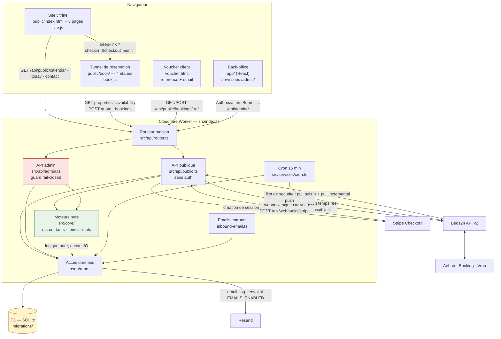

# Architecture — Gites Platform

> À lire **en premier** quand on découvre le code.
> Ce document explique *comment le système est construit*. Le `README.md` explique
> *ce que le produit fait* (règles métier, décisions, runbooks de déploiement) —
> les deux sont complémentaires, aucun ne remplace l'autre.
> Pour installer et contribuer : `CONTRIBUTING.md`.

---

## 1. Vue d'ensemble en une page

**Le produit.** Une plateforme de location saisonnière pour deux domaines :
**Les Gîtes du Pré Moré** (Redu — 2 maisons + « Domaine entier ») et
**Le Moulin de Braives**. Elle remplace elloha (~857 €/an) et fait trois choses :

1. un **site vitrine public** qui présente les lieux et amène au tunnel de réservation ;
2. un **tunnel de réservation** en 4 étapes avec paiement Stripe ;
3. un **back-office** où le propriétaire pilote tout (planning, tarifs, clients, messages, canaux OTA).

**La contrainte technique qui structure tout le reste.** Les deux maisons du Pré Moré
se louent **seules ou ensemble**. Réserver « La Scierie » doit bloquer instantanément
« Le Domaine entier », et inversement. C'est le point où presque tous les
concurrents échouent, et c'est le cœur du code.

**Le choix de stack.** Cloudflare Workers + D1 (SQLite), TypeScript strict,
**zéro dépendance à l'exécution**. Pas de framework front, pas d'ORM, pas de SDK
Stripe : des `fetch` vers des API REST et du SQL écrit à la main. Ce n'est pas de
l'ascétisme — c'est ce qui permet de faire tourner le même `src/` sur Cloudflare
**et** sur un hébergement Node classique (cf. §9) sans rien réécrire.

| Couche | Choix | Où |
|---|---|---|
| Runtime | Cloudflare Workers (TypeScript strict) | `src/index.ts` |
| Base | Cloudflare D1 (SQLite) | `migrations/` |
| Front | HTML/CSS/JS vanilla en modules ES, servi en assets | `public/` |
| Paiement | Stripe Checkout via API REST — **mode stub sans clé** | `src/services/stripe.ts` |
| Emails | Resend — **mode stub par défaut**, tout journalisé en base | `src/services/email.ts` |
| OTA | Beds24 API v2 (Airbnb/Booking) + iCal | `src/services/beds24*.ts`, `ical.ts` |
| Tests | Vitest (pool Node) + Miniflare pour la vraie D1 | `test/` |

**Chiffres au 2026-08-05** : 152 tests verts, `npm run typecheck` propre,
12 migrations, ~80 endpoints, 15 vues de back-office, 6 pages publiques.

---

## 2. Le flux, de bout en bout



**Lecture rapide du chemin critique** (une réservation en ligne) :

1. Le visiteur choisit ses dates sur le site vitrine ou directement dans `/book/`.
2. `book.js` appelle `GET /api/public/availability` → la disponibilité est calculée
   **en TypeScript pur** (`src/core/availability.ts`), liaisons comprises.
3. `POST /api/public/quote` → devis calculé nuit par nuit (`src/core/pricing.ts`).
4. `POST /api/public/bookings` → **c'est ici que tout se joue** : `createBookingAtomic`
   revérifie la disponibilité *et* insère la réservation dans **une seule instruction SQL**.
   Statut `pending`, option (« hold ») de 30 minutes.
5. Paiement à l'étape 4 : formulaire Stripe **intégré à la page** (Payment
   Element) si les deux clés sont posées, sinon redirection vers Checkout — ou
   vers `/book/dev-pay.html` en local sans clé.
6. Le webhook Stripe confirme la résa (`confirmBookingAtomic`), journalise le voucher,
   et déclenche un push Beds24. **C'est lui qui fait foi, jamais le retour
   navigateur** — Bancontact ramène le client avant même que sa banque n'ait
   tranché.

---

## 3. Le principe non négociable : disponibilité liée + insertion atomique

C'est la seule partie du code qu'il faut vraiment comprendre avant de toucher quoi que ce soit.

### Le modèle de liaison

Une ligne de la table `unit_links` :

```sql
CREATE TABLE unit_links (
  unit_id        INTEGER NOT NULL REFERENCES units(id),
  blocks_unit_id INTEGER NOT NULL REFERENCES units(id),
  PRIMARY KEY (unit_id, blocks_unit_id),
  CHECK (unit_id <> blocks_unit_id)
);
```

signifie : *« toute réservation active sur `unit_id` rend `blocks_unit_id`
indisponible sur les mêmes nuits »*.

La relation est **directionnelle**. La réciprocité s'obtient en insérant les deux
sens — ce que fait le seed comme `setMutualLinks()` (`src/db/repo.ts`).
Pour le Pré Moré, 4 lignes : `(1,3) (2,3) (3,1) (3,2)`
(1 = Maison du Scieur, 2 = La Scierie, 3 = Domaine entier).

Le modèle est générique : n'importe quelle unité future peut être liée à n'importe
quelle autre, sans toucher au code.

### L'insertion atomique

`createBookingAtomic()` (`src/db/repo.ts`, ~ligne 485) est **la** requête critique.
Elle fait la vérification de disponibilité et l'insertion dans **un seul `INSERT … SELECT … WHERE NOT EXISTS`** :

```sql
INSERT INTO bookings (…)
SELECT  …, <référence générée à la volée>, …
WHERE NOT EXISTS (
  SELECT 1 FROM bookings b
   WHERE b.checkin < ?4 AND b.checkout > ?3
     AND (b.status = 'confirmed' OR (b.status = 'pending' AND b.hold_expires_at > ?5))
     AND b.unit_id IN (
       SELECT ?1
       UNION ALL
       SELECT ul.unit_id FROM unit_links ul WHERE ul.blocks_unit_id = ?1
     )
)
```

`res.meta.changes !== 1` ⇒ conflit, la réservation n'a pas eu lieu. Il n'y a
**aucune fenêtre** entre le « est-ce libre ? » et le « je réserve ».

À cette clause s'ajoute, depuis l'issue #74, un second `NOT EXISTS` sur la table
`manual_blocks` (blocages manuels : travaux, usage personnel). Il emprunte la
**même expansion par `unit_links`** et vit dans une seule fonction,
`manualBlockConflictSql()` — recopié à la main dans cinq requêtes, il aurait
divergé. Symétriquement, `createManualBlockAtomic()` est le pendant exact de
`createBookingAtomic()` : un blocage et une réservation lancés en même temps sur
le même créneau ne peuvent jamais passer tous les deux.

Un blocage n'est **pas** une réservation : rien dans `bookings`, donc rien dans
les statistiques de vente, les exports comptables ni les relances — qui ne
lisent que cette table-là. Mais il occupe le stock, part dans l'export iCal et
ferme les calendriers poussés aux OTA.

> [!warning]
> **Ne jamais remplacer ce chemin par un `SELECT` puis un `INSERT`.** Deux clients
> simultanés passeraient tous les deux. C'est précisément ce que prouve
> `test/booking-db.test.ts` § « COURSES — réservations simultanées ».

### La double implémentation, assumée

La même logique existe **deux fois** :

| Implémentation | Fichier | Rôle |
|---|---|---|
| SQL atomique | `src/db/repo.ts` (`createBookingAtomic`, `confirmBookingAtomic`, `updateBookingDatesAtomic`, `updateBookingStayAtomic`, `createManualBlockAtomic`) | **La vérité transactionnelle.** Seule garantie anti-surbooking. |
| TypeScript pur | `src/core/availability.ts` (`isUnitFree`, `busySpans`, `blockingUnitIds`, `blocksAsSpans`) | Recherche publique, planning, export iCal, push Beds24. |

Ce n'est pas une duplication accidentelle : la version TS sert à *afficher*,
la version SQL sert à *engager*. Les deux sont couvertes par les mêmes cas de test.
**Si vous modifiez la règle de blocage, modifiez les deux** — et vérifiez que
`test/availability.test.ts` (matrice A/B/Domaine) et `test/booking-db.test.ts`
(même matrice au niveau SQL) passent tous les deux.

### Convention de dates

Les nuitées forment l'intervalle **semi-ouvert `[arrivée, départ)`**.
Un départ et une arrivée le même jour sont compatibles (rotation le jour même,
arrivée 18:00 / départ 18:00 depuis la migration 0009).
Tous les montants sont en **centimes entiers**, jamais en flottants.

---

## 4. Couche par couche

### 4.1 Point d'entrée — `src/index.ts` (68 lignes)

Trois handlers, c'est tout :

| Handler | Déclencheur | Ce qu'il fait |
|---|---|---|
| `fetch` | Requête HTTP | Passe au routeur ; si aucune route ne matche → `env.ASSETS.fetch()` sert le fichier statique. Une exception non rattrapée est journalisée dans `audit_log` (`action = 'unhandled.error'`) avant le 500 — sans ça, un webhook Stripe qui plante ne laissait aucune trace consultable. |
| `scheduled` | Cron `*/15 * * * *` | `ctx.waitUntil(runScheduled(env))` |
| `email` | Cloudflare Email Routing | Parse le MIME, stocke, rattache à la résa, accuse réception, transfère |

Les routes dynamiques sont déclarées dans `wrangler.jsonc` sous
`assets.run_worker_first: ["/api/*", "/ical/*", "/"]` — tout le reste part
directement aux assets sans réveiller le Worker.

### 4.2 Routage — `src/api/router.ts` (76 lignes)

Mini-routeur maison, zéro dépendance. Patterns `/a/:id/b`, méthodes
`get/post/patch/put/delete`. `handle()` renvoie `null` si rien ne matche (le
Worker sert alors l'asset). Helpers `json()`, `apiError()`, `readJson()`.

Signature d'un handler :

```ts
(req, env, params, url, ctx?) => Promise<Response> | Response
```

Le **5ᵉ argument `ctx`** (`ExecutionContext`) est optionnel et rétro-compatible :
il permet de différer du travail après la réponse (`ctx.waitUntil`) — c'est ce
qui rend le push Beds24 temps réel gratuit en latence. Il est absent dans les
tests, où les helpers retombent sur un `await` inline.

### 4.3 API publique — `src/api/public.ts` (696 lignes)

**Aucune authentification.** Donc : validation stricte des entrées
(`parseStay()` — max 60 nuits, max 2 ans d'avance, 1-30 adultes), aucune fuite
d'information, et la disponibilité finale toujours regarantie par l'INSERT atomique.

| Endpoint | Méthode | Rôle |
|---|---|---|
| `/api/public/properties` | GET | Liste des domaines (landing multi-biens) |
| `/api/public/properties/:slug` | GET | Fiche domaine : unités, options, réglages, texte CGV |
| `/api/public/availability` | GET | Unités réservables sur une période + devis joints + **plages valides les plus proches** quand rien ne passe (#66) |
| `/api/public/photos` | GET | **Galerie d'un hébergement** (`?property=&unit=`) — les pages de gîtes la servent en HTML et rejouent l'ordre du back-office par-dessus (#32) |
| `/api/public/calendar` | GET | Calendrier mensuel : dispo, prix « dès X € », **minimum de nuits et jours d'arrivée** par jour |
| `/api/public/quote` | POST | Devis détaillé (recalculé à chaque changement d'option) |
| `/api/public/hold` | GET | **Réservation en cours de ce visiteur** (cookie signé) — reprise du tunnel (#68) |
| `/api/public/bookings` | POST | **Création de la réservation** + session de paiement, ou **reprise** du hold en cours (#68) |
| `/api/public/bookings/:reference` | GET | Voucher — exige référence **et** email |
| `/api/public/bookings/:reference/pay` | POST | Reprise d'un paiement interrompu, **ou paiement du solde** d'une résa confirmée (libre-service, issue #67) |
| `/api/public/bookings/:reference/messages` | GET/POST | Fil de conversation client |
| `/api/public/contact` | POST | Formulaire « une question avant de réserver ? » (pot de miel) |
| `/api/public/today` | GET | Date serveur (Europe/Brussels) + drapeau `demo` |
| `/api/public/dev-pay/info` · `/confirm` | GET/POST | Simulateur de paiement local |
| `/api/webhooks/stripe` | POST | Signature HMAC vérifiée, tolérance 5 min |
| `/api/webhooks/beds24` | POST | Notification canal — clé secrète en query |
| `/ical/:token` | GET | Export iCal par unité (token secret) |

Détail juridique intégré : `POST /api/public/bookings` **exige `cgvAccepted: true`**
et trace la preuve — version hashée (sha256) du texte affiché + horodatage serveur
+ IP (`recordCgvAcceptance`, migration 0008). L'opt-in marketing est stocké
séparément, jamais pré-coché, jamais rétrogradé par une résa suivante.

### 4.4 API back-office — `src/api/admin.ts` (1510 lignes)

**Toutes les routes sont derrière `guard()`, sauf `POST /api/admin/login`** (qui ne
renvoie aucune donnée métier — juste oui/non + session).

Le `guard` est **fail-closed** et accepte trois formes, dans cet ordre :

1. `Authorization: Bearer session:<jeton>` — session d'un compte en base (30 jours) ;
2. `Authorization: Bearer <user>:<motdepasse>` ou `<motdepasse>` nu — secret
   `ADMIN_TOKEN` (accès de secours « break-glass »), comparaison à temps constant ;
3. En-tête `Cf-Access-Jwt-Assertion` — Cloudflare Access a déjà authentifié en amont.

Sans rien de tout ça : **503** si aucun compte n'existe en base (« verrou non armé »),
**401** dès qu'un compte existe (→ page de login). L'ancienne version ne vérifiait
rien quand `ADMIN_TOKEN` était absent — ce qui est la valeur par défaut de
`.dev.vars.example`, donc exposait tout le fichier clients (corrigé au LOT A0).

Les ~70 endpoints admin couvrent : comptes utilisateurs, référentiel
(propriétés/unités/liaisons), tableau de bord, planning, réservations et vente
manuelle, paiements, saisons et règles tarifaires, promotions, options, clients,
statistiques + exports CSV, réglages, iCal, import elloha, messages, relance du solde
(`POST /bookings/:id/balance-reminder`, issue #69), checklist de mise en route,
journal d'audit, et Beds24 (status/push/pull/invite-code).

### 4.5 Moteurs purs — `src/core/`

**Aucun I/O, aucune dépendance à D1, entièrement déterministes.** C'est là qu'il
faut écrire les tests en premier — ils tournent en millisecondes.

| Fichier | Rôle |
|---|---|
| `dates.ts` | `IsoDate`, `addDays`, `diffDays`, `eachNight`, `rangesOverlap`, `todayInZone` (Europe/Brussels), `sqlNow` |
| `holidays.ts` | Fériés belges **calculés** (computus de Gauss/Butcher pour Pâques) + veilles + ponts |
| `availability.ts` | `isUnitFree`, `busySpans`, `blockingUnitIds`, `mergeSpans` — la logique de liaison |
| `pricing.ts` | `computeQuote` (le devis) et `rateCalendar` (prix jour par jour) |
| `stats.ts` | `computeYearStats` — occupation, revenus, par mois et par unité |

**L'empilement des règles de `computeQuote`**, dans l'ordre :

1. Saison de chaque nuit (priorité la plus haute gagne ; sinon tarif de base) ;
2. Type de nuit — semaine / weekend (vendredi + samedi) ; puis majoration %
   automatique sur nuits fériées, veilles et ponts ;
3. Remises automatiques : **la meilleure seule** (long séjour / early bird /
   last minute ne se cumulent pas) ; un code promo s'ajoute **ensuite** ;
4. Frais de ménage fixes (jamais remisés), options payantes, taxe de séjour.

Les remises portent sur le **sous-total hébergement uniquement**. Une unité
composite en mode `sum` tarife chaque maison avec **ses** règles et cumule les
ménages (Domaine = 120 + 90 = 210 €).

### 4.6 Accès aux données — `src/db/repo.ts` (1660 lignes)

**Toute** la couche D1 vit ici. Aucun SQL ailleurs dans `src/` (à une exception
près : le repli `audit_log` de `index.ts`). SQL écrit à la main, requêtes
préparées et bindées — pas d'ORM.

Trois fonctions méritent une attention particulière, toutes **atomiques** :

- `createBookingAtomic()` — cf. §3 ;
- `confirmBookingAtomic()` — confirme un `pending` **en revérifiant le conflit**
  (un webhook Stripe tardif ne doit pas confirmer un créneau repris) ;
- `updateBookingDatesAtomic()` — déplacement d'une résa canal, même garde ;
- `updateBookingStayAtomic()` — modification côté back-office (dates **et/ou**
  logement) : l'ancien créneau est libéré et le nouveau pris par la même
  instruction, donc jamais d'instant où la réservation occupe les deux ou aucun.
  Annuler-recréer aurait rouvert l'ancien créneau le temps de la bascule, et
  perdu paiements et preuve CGV au passage (issue #73).

Le reste est du CRUD typé : `PropertyRow`, `UnitRow`, `BookingRow`, `PaymentRow`,
`MessageRow`, etc., chacun avec son mapper depuis la ligne SQL brute.

### 4.7 Services — `src/services/`

| Fichier | Rôle |
|---|---|
| `admin-auth.ts` | Comptes back-office : PBKDF2-SHA256 (30 000 itérations), sessions à jeton (seul le SHA-256 est stocké), mots de passe générés `mot-mot-mot-NN` dictables au téléphone |
| `settings.ts` | Réglages **globaux** clé/valeur (`app_settings`) — modifiables sans redéploiement |
| `booking-flow.ts` | Flux partagé public/admin : `quoteFromContext`, `startCheckout`, `handlePaymentSuccess` (idempotent), `sendConfirmation` (mail + PDF « Confirmation de réservation et conditions générales », cf. docs/confirmation-pdf.md) |
| `stripe.ts` | Checkout par API REST, **stub sans clé**, vérification HMAC du webhook |
| `email.ts` | Construction des emails (voucher, lien de paiement, rappel de solde) + `queueEmail` → `email_log` |
| `ical.ts` | `buildIcs` (export), `parseIcs` (import), `syncFeed` |
| `beds24.ts` | Auth API v2 (token 24 h auto-renouvelé, cache 20 h), `beds24WritesAllowed` |
| `beds24-sync.ts` | Sortant (`pushCalendars`, `triggerBeds24Push`) et entrant (`applyChannelBookings`, `pullBeds24Bookings`) |
| `elloha-import.ts` | Import CSV avec simulation préalable (`dryRun`) |
| `inbound-email.ts` | Parseur MIME maison (multipart, quoted-printable, base64, encoded-words) + rattachement |
| `mailbox.ts` | Relève IMAP de la boîte de contact (Node seulement), rattachement, curseur UID — cf. `docs/messagerie.md` |
| `cron.ts` | Les 4 étapes planifiées, **chacune dans son propre try/catch** |

> [!note]
> Le `try/catch` par étape dans `cron.ts` n'est pas décoratif : une panne sur
> l'expiration des holds interrompait auparavant tout le cron — donc les flux iCal,
> les rappels de solde et le push Beds24 — sans la moindre trace.

**Les modes stub sont la valeur par défaut, et c'est voulu.** Sans clé Stripe,
`createCheckoutSession` renvoie une URL locale `/book/dev-pay.html`. Sans
`EMAILS_ENABLED=true`, aucun email ne part : tout est journalisé dans `email_log`.
Un contributeur peut donc dérouler un parcours de réservation complet en local
sans compte tiers et sans risquer d'écrire à un vrai client.

### 4.8 Base de données — `migrations/`

16 migrations, appliquées dans l'ordre alphabétique du nom de fichier.
**Aucun script de rollback** — les migrations sont à sens unique.

| Table | Une ligne | Créée en |
|---|---|---|
| `properties` | Les domaines (Pré Moré, Moulin) — préfixe de référence `PM`/`MB`, commune pour la taxe | 0001 (+`beds24_property_id` en 0010) |
| `units` | Les hébergements vendables, y compris les composites comme « Domaine entier » | 0001 (+ménage/photo en 0003, +`beds24_room_id` en 0010, +`deposit_pct` en 0015) |
| `unit_links` | **Le cœur** : quelle unité en bloque quelle autre (cf. §3) | 0001 |
| `manual_blocks` | Blocages manuels (travaux, usage perso) — occupent le stock, jamais une vente | 0018 |
| `seasons` | Périodes tarifaires par domaine ; la priorité la plus haute gagne | 0001 |
| `rate_rules` | Une grille de prix par (unité, saison) ; `season_id NULL` = tarif de base | 0001 |
| `promotions` | Remises auto (long séjour / early bird / last minute) et codes promo | 0001 |
| `options` | Extras payants (sauna, bain chaud, bois) | 0001 |
| `guests` | CRM léger, dédoublonné par email | 0001 (+opt-in marketing en 0008) |
| `bookings` | Les réservations — **jamais supprimées**, l'annulation est un statut | 0001 (+preuve CGV en 0008) |
| `payments` | Paiements et remboursements (montant négatif) rattachés à une résa | 0001 |
| `ical_feeds` | Flux iCal entrants (Airbnb → nous) | 0001 |
| `email_log` | Journal des emails sortants — statut `stub` par défaut | 0001 (+`error_detail` en 0011) |
| `audit_log` | Trace de toute écriture significative (`actor`, `action`, `entity`, `detail`) | 0001 |
| `settings` | Réglages **par domaine**, clé/valeur, PK composite `(property_id, key)` | 0001 |
| `messages` | Fils de conversation clients, entrants et sortants, 3 canaux | 0005 (`inbound_emails`), renommée en 0006 |
| `checklist_items` | Checklist de mise en route affichée dans le back-office (22 items) | 0007 |
| `admin_users` | Comptes du back-office (PBKDF2) | 0012 |
| `admin_sessions` | Sessions, indexées par SHA-256 du jeton | 0012 |
| `app_settings` | Réglages **globaux** à l'application (≠ `settings`, qui est par domaine) | 0012 |
| `unit_photos` | Une photo de galerie : chemin de l'asset commité, texte alternatif, légende, ordre, retrait — la photo principale d'un hébergement en est dérivée à la lecture | 0021 (issue #32) |
| `sync_conflicts` | Ce qu'un canal annonce et que nous n'avons pas pu refléter — une ligne par conflit distinct, `open` / `resolved` / `ignored` | 0017 |

**Contraintes structurantes** :

```sql
bookings.status CHECK (status IN ('pending', 'confirmed', 'cancelled'))
bookings.source CHECK (source IN ('direct', 'manual', 'ical', 'import'))
bookings        CHECK (checkin < checkout)
```

Trois index UNIQUE partiels portent l'idempotence de tout le système :
`idx_bookings_external_uid` (rejeu iCal/Beds24), `idx_payments_session`
(rejeu webhook Stripe), `idx_inbound_message_id` (redélivrance email).

> [!warning]
> **Règle de rédaction des migrations : jamais de `;` ni de `--` à l'intérieur
> d'un littéral SQL.** Le découpage des fichiers est volontairement naïf — il
> retire les `--` en fin de ligne puis `split(";")` — et il est implémenté
> **deux fois** : `test/helpers/d1.ts` et `node/migrate.mjs`. Un point-virgule
> dans une chaîne casse silencieusement la migration.

**Données de seed** : 0002 charge le Pré Moré (3 unités, 4 liaisons, 3 saisons,
6 règles tarifaires, 3 promos, 5 options, réglages) ; 0004 ajoute le Moulin de
Braives. Un `npm run db:migrate:local` sur une base neuve donne donc un système
immédiatement utilisable. Les tarifs restent des **placeholders `TODO_TARIFS`** —
la grille réelle du site est « sur demande ».

### 4.9 Front-end — `public/`

**Aucun build, aucun framework, aucune dépendance npm.** Des modules ES écrits à
la main, servis tels quels. Voir §5 pour la séparation public / back-office.

### 4.10 Tests — `test/`

12 fichiers, **152 tests**, ~9 secondes.

| Fichier | Couvre |
|---|---|
| `availability.test.ts` | Matrice de liaison A/B/Domaine, bornes de chevauchement, holds |
| `booking-db.test.ts` | Même matrice **au niveau SQL** + **les courses** (2 clients simultanés → 1 gagnant) |
| `pricing.test.ts` | Saisons, weekend, fériés, remises, promos, options, taxe, composite, ménage |
| `holidays.test.ts` | Computus de Pâques, fériés légaux belges, ponts |
| `api.test.ts` | Parcours de réservation complet en mode stub, routes admin, login par session |
| `lot-a0.test.ts` | Les scénarios de panne : webhook tardif, paiement orphelin, flux iCal vide, remise à 150 %, injection CSV |
| `ical.test.ts` · `elloha-import.test.ts` · `inbound-email.test.ts` · `messages.test.ts` | Les intégrations |
| `beds24-sync.test.ts` · `beds24-invite.test.ts` | Push/pull canaux, câblage temps réel bout en bout |

> [!warning]
> **Le piège du chemin emoji.** `@cloudflare/vitest-pool-workers` est
> **inutilisable ici** : son service de fallback de modules ne résout plus rien
> quand le chemin du projet contient un emoji (`🔧 Dev/…`) — `ERR_RUNTIME_FAILURE`,
> `No such module "node:vm"`. Vérifié le 2026-07-12 : la même suite est verte
> dans un chemin ASCII.
>
> **La parade est déjà en place** : `vitest.config.ts` utilise le pool Node
> standard, et les tests qui ont besoin d'une **vraie D1** passent par
> **Miniflare piloté directement** — `test/helpers/d1.ts`, fonction
> `createTestDb()`, base en mémoire isolée par instance avec toutes les
> migrations rejouées. Même moteur workerd, même sémantique SQLite.
>
> N'essayez pas de « réparer » ça en réinstallant `vitest-pool-workers` :
> ça ne marchera pas tant que le dossier vit sous un chemin avec emoji.

---

## 5. Site public vs back-office — **la séparation à connaître**

C'est la frontière sur laquelle les deux contributeurs vont travailler.
Elle est nette **des deux côtés** : front et API.

### 5.1 Vue d'ensemble

| | **Site public** | **Back-office admin** |
|---|---|---|
| URL | `/`, `/la-propriete/`, `/book/`… | `/admin/` |
| Fichiers front | `public/` **hors** `admin/` | `app/` (construit dans `public/admin/`) |
| API | `src/api/public.ts` | `src/api/admin.ts` |
| Préfixe | `/api/public/*`, `/api/webhooks/*`, `/ical/*` | `/api/admin/*` |
| Authentification | **Aucune** | `guard()` fail-closed sur **toutes** les routes sauf `/login` |
| Protection prod | — | Cloudflare Access **+** `ADMIN_TOKEN` (les deux, pas l'un ou l'autre) |
| Indexation | Ouverte | `<meta name="robots" content="noindex">` |
| CSS | `public/site.css` (vitrine) + `public/book/book.css` (tunnel) | `app/src/styles.css` + Mantine |

### 5.2 Le site public

**Six pages, dont une seule contient du JavaScript.**

| Page | Fichier | Contenu |
|---|---|---|
| Accueil | `public/index.html` (269 l.) | Hero, les 2 gîtes, expérience, **calendrier de dispo live**, tarifs, contact |
| La propriété | `public/la-propriete/index.html` | 100 % statique — carte Google MyMaps, Natura 2000, la roue, le réservoir |
| Histoire | `public/histoire/index.html` | 100 % statique — chronologie 1674 → 1992, la restauration |
| Que faire | `public/que-faire/index.html` | 100 % statique — activités par distance (sur place, 5-15 km, 15-35 km) |
| Que manger | `public/que-manger/index.html` | 100 % statique — producteurs locaux, le four à pain |
| Infos pratiques | `public/infos-pratiques/index.html` | 100 % statique — poubelles, chasse, groupes |

Les 5 pages de contenu n'ont **aucune balise `<script>`**. Seul `public/site.js`
(172 lignes, sur l'accueil uniquement) appelle l'API :

- `GET /api/public/today` → borne passé/futur du calendrier ;
- `GET /api/public/calendar?property=pre-more&month=YYYY-MM` → dispo + prix par jour (mémoïsé) ;
- `POST /api/public/contact` → formulaire, avec pot de miel `website`.

Les prix « dès X € » sont calculés **côté client** (min sur les deux mois affichés)
et injectés dans les `[data-price-unit="1|2|3"]`. En cas d'échec, tout dégrade
proprement vers « sur demande » et « Calendrier momentanément indisponible ».

**Le passage vitrine → tunnel se fait uniquement par deep-link** :

```
/book/?property=pre-more
/book/?property=pre-more&unit=maison-du-scieur
/book/?property=pre-more&checkin=2026-08-12&checkout=2026-08-15
```

Le calendrier de l'accueil construit dynamiquement le CTA (« Réserver du X au Y »).

> [!note]
> La navigation et le pied de page sont **dupliqués par copier-coller dans chaque
> fichier** — il n'y a ni templating ni include. Toucher au menu = éditer 6 fichiers.
> C'est un choix assumé (zéro build), pas un oubli.

### 5.3 Le tunnel de réservation — `public/book/`

`book.js` (606 lignes) a deux modes, décidés au chargement :

- **sans `?property=`** → landing : une carte par domaine (`GET /api/public/properties`) ;
- **avec `?property=`** → le tunnel en 4 étapes : Dates → Hébergement → Coordonnées → Paiement.

Points d'implémentation qui surprennent au premier abord :

- **Il n'y a pas de bouton « Rechercher »**. La recherche part toute seule
  (débounce 200 ms) dès qu'arrivée + départ sont choisis.
- **Auto-sélection de l'unité** quand une seule est réservable, ou quand un
  deep-link `?unit=` la désigne.
- L'état de sélection est persisté sous la clé localStorage
  **`gites-book:<slug>`** (TTL 30 jours) **et** répliqué dans l'URL via
  `history.replaceState` — l'URL est donc toujours partageable.
- Des compteurs monotones (`searchSeq`, `quoteSeq`) écartent les réponses obsolètes.
- **Les règles de séjour sont écrites, pas seulement appliquées** (#66) : le
  minimum de nuits s'affiche dans chaque case du calendrier et se résume par
  période sous la grille, les jours d'arrivée imposés hachurent les cases
  concernées. Un séjour refusé dit pourquoi et propose une ou deux plages
  réservables, calculées serveur sur les vraies disponibilités — plus jamais
  un « indisponible » sec.
- **Le hold appartient au visiteur, pas au calendrier** (#68) : à la création
  d'une option, le serveur pose un cookie `gp_hold` HttpOnly portant la
  référence **signée** (HMAC-SHA256, clé dérivée d'`ADMIN_TOKEN` par hachage à
  domaine séparé — cf. `src/services/hold-session.ts`). Ce cookie sert à trois
  choses, et à rien d'autre : la recherche ignore le propre blocage du
  visiteur, `GET /api/public/hold` rouvre son étape avec le devis exact qui a
  été bloqué, et un nouveau `POST /api/public/bookings` **reprend** ce hold si
  hébergement, dates, client et devis sont identiques (aucune ligne créée,
  donc aucun impact sur le plafond anti-abus de l'issue #6). Au moindre écart,
  l'ancien hold est **libéré avant** la nouvelle insertion — sinon le client se
  bloquerait lui-même. Le hold n'est jamais prolongé : le décompte reste celui
  posé au départ. Sans `ADMIN_TOKEN`, la reprise est simplement désactivée.

Pages de retour : `merci.html` (poll toutes les 1,5 s jusqu'à `confirmed`, 20 essais),
`annule.html` (rassurance + reprise), `voucher.html` (espace client authentifié par
**référence + email**, avec fil de conversation et bouton de reprise de paiement),
`dev-pay.html` (simulateur local avec décompte honnête du hold).

### 5.4 Le back-office — `app/`, servi sous `/admin/`

Une application React (Vite + Mantine + TanStack Router/Query, textes Lingui
FR/NL), dans `app/`, construite par `npm run build` dans `public/admin/`
(non versionné) et servie sous `/admin/` par le Worker comme par Node. Routage
en hash (`/admin/#/calendrier`) : un seul fichier à servir. Depuis le
10/10/2026 c'est la seule adresse : l'ancien écran vanilla (`app.js`,
`config.js`, `login.html`) a été retiré ; `/admin2/…` et `/admin/login.html`
redirigent (`src/core/admin-redirect.ts`), et les anciennes adresses d'écran
(`#/dash`, `#/resa`, `#/canaux`…) mènent au bon écran (`app/src/router.tsx`).

À l'ordinateur (≥ 1024 px), barre latérale par rubriques : *Quotidien*
(Aujourd'hui, Calendrier, Réservations, Messages, Ménage), *Clients et argent*,
*Prix*, *Plateformes*, *Réglages* (`app/src/shell/nav.tsx`). Au téléphone,
barre d'onglets du bas et « Plus ».

### 5.5 L'authentification admin, en pratique

C'est le point le plus subtil du projet. Il existe **deux mécanismes**, coexistants :

**A. Comptes en base** (`admin_users`, migration 0012) — le mode normal.

L'écran de connexion (`/admin/#/connexion`) → `POST /api/admin/login {user, password}` → si le compte existe en
base et que PBKDF2 valide → le serveur crée une session de 30 jours et renvoie
`{session}`. Le navigateur stocke `localStorage.gp_session` et envoie ensuite
`Authorization: Bearer session:<jeton>`. Seul le **SHA-256** du jeton est en base :
une fuite de la base ne permet pas de rejouer les sessions.

Les comptes se gèrent entièrement depuis Réglages › Comptes (`#/reglages/comptes`) : création (le **mot de passe
est généré par le serveur** au format `mot-mot-mot-NN`, dictable au téléphone, et
**affiché une seule fois**), réinitialisation, désactivation, suppression.
Désactiver ou réinitialiser **coupe les sessions ouvertes**. On ne peut ni se
désactiver ni se supprimer soi-même.

**B. Secret `ADMIN_TOKEN`** — l'accès de secours (« break-glass »).

Format : liste `identifiant:motdepasse` séparée par des virgules
(`julien:…,matthieu:…`), révocable une paire à la fois en republiant le secret.
L'ancien format à jeton unique reste accepté. Dans ce mode il n'y a **pas de
session** : le navigateur conserve `gp_user` + `gp_token` et la garde revérifie à
chaque requête. Comparaison à temps constant, avec comparaison factice quand
l'identifiant est inconnu (pour ne pas fuiter son existence par le chronomètre).

**Sur une base neuve, `admin_users` est vide** — c'est donc `ADMIN_TOKEN` qui
ouvre la porte, et c'est depuis cet accès qu'on crée les vrais comptes.
Sans `ADMIN_TOKEN` ni compte en base : **503, tout est refusé**.

> [!warning]
> En production, `/admin` **et** `/api/admin/*` doivent être couverts par
> Cloudflare Access. Ce sont deux surfaces distinctes : une règle posée seulement
> sur `/admin` laisse les endpoints de données grands ouverts. Il faut aussi
> désactiver la route `*.workers.dev` par défaut, qui contourne les règles du
> domaine custom.

---

## 6. Sécurité — ce qui est déjà en place

À connaître avant de toucher aux zones concernées, pour ne pas défaire une protection :

- **Garde admin fail-closed** — sans jeton valide ni en-tête Cloudflare Access, refus.
- **Webhook Stripe** — signature HMAC-SHA256 vérifiée, tolérance d'horloge 5 min,
  comparaison à temps constant.
- **Écritures Beds24 réservées à la production** (`beds24WritesAllowed()`) : le
  compte Beds24 n'a **pas de bac à sable**, une session de dev pousserait des prix
  de test jusqu'aux OTAs.
- **Exports CSV** — neutralisation de l'injection de formule Excel (`=`, `+`, `-`, `@`).
- **Voucher public** — accessible avec référence **et** email, jamais l'un seul.
- **Simulateur dev-pay** — désactivé automatiquement dès qu'une clé Stripe existe.
- **Jamais de `DELETE` sur les réservations** — l'annulation est un statut ;
  `audit_log` sur toutes les écritures significatives.
- **XSS** — chaque fichier front définit son `esc()` et toute donnée serveur
  interpolée y passe.
- **Pot de miel** sur le formulaire de contact public.
- **Formulaire de réservation** — plafonds de holds et de cadence (par email et
  par IP) toujours actifs, plus **Turnstile** quand les deux clés sont
  configurées (`src/services/turnstile.ts`, éteint sans clés). Le jeton est
  vérifié avant toute écriture et n'est jamais journalisé.

---

## 7. Les intégrations externes

### Stripe

API REST directe, sans SDK. **Deux interfaces de paiement, un seul chemin de
crédit** (issue #26) :

- **Payment Element** (défaut dès que `STRIPE_SECRET_KEY` **et**
  `STRIPE_PUBLISHABLE_KEY` existent) : un `PaymentIntent` est créé côté serveur,
  le formulaire se monte dans la page — carte, Bancontact, Apple/Google Pay.
  `js.stripe.com` n'est chargé que si `GET /api/public/payment-config` annonce
  une clé publique.
- **Checkout hébergé** (`STRIPE_UI=checkout`, ou clé publique absente) : le flux
  historique par redirection. Toujours utilisé par les **liens de paiement** que
  le back-office envoie par email — un email a besoin d'une URL, pas d'un
  `client_secret`.

Les deux écrivent leur identifiant Stripe (`pi_…` ou `cs_…`) dans **la même**
colonne de réconciliation `payments.stripe_session_id`, protégée par l'index
UNIQUE partiel `idx_payments_session`. D'où : aucune migration, et une seule
idempotence à maintenir. `handlePaymentSuccess()` est **idempotent** : un même
identifiant traité deux fois ne confirme et n'envoie le voucher qu'une seule
fois. `payment_intent.payment_failed` solde la tentative **sans toucher à la
réservation** — le hold de 30 minutes reste payable.

Session Checkout éphémère alignée sur le hold de 30 minutes.

L'idempotence ne couvre qu'**une** session. Contre le risque voisin — deux
sessions distinctes pour le même montant (multi-onglets, reclic sur « Payer le
solde »), toutes deux payables —, `startCheckout()` ferme d'abord chez Stripe
(`checkout/sessions/{id}/expire`) toute session encore ouverte sur la
réservation. Si l'une aboutit malgré tout, l'argent est encaissé et le
trop-perçu remonte dans la carte « Santé » du tableau de bord : jamais avalé
en silence.

Trois cas dégradés sont traités explicitement et tracés en `audit_log` :
`payment.orphaned` (créneau repris pendant le paiement — argent encaissé, séjour
impossible), `payment.overpaid`, et l'échec de voucher (qui **ne doit jamais**
faire échouer le webhook, sinon Stripe retomberait au retry sur un paiement déjà
`succeeded` et ne réessaierait jamais).

### Beds24 (canal OTA — Airbnb, Booking, Vrbo)

Propriété `#344555`, rooms `#711713` (Scieur) et `#711714` (Scierie).
Le « Domaine entier » reste **direct-only** : sa liaison est déjà reflétée dans
les calendriers des deux maisons.

La synchro est **événementielle**, pas périodique :

- **Sortant** : `triggerBeds24Push` en `ctx.waitUntil` à chaque mutation (résa
  publique, vente manuelle, annulation, saisons, règles tarifaires) — zéro latence
  ajoutée à la réponse.
- **Entrant** : webhook `POST /api/webhooks/beds24?key=…`. La notification est un
  **signal**, jamais une source de vérité : on déclenche un pull immédiat suivi
  d'un push.
- **Le cron 15 min n'est qu'un filet de sécurité** (holds expirés, échecs réseau,
  webhooks perdus).

Les **prix poussés** sont ceux de la vente directe, sauf si un *canal de
référence* est appliqué (issue #31, réglage `pricing.push_channel`) : `price1`
est alors majoré de son pourcentage. Le prix direct en base n'est jamais touché —
la majoration est calculée au moment du push, dans `buildCalendarPush`.

Nos dates priment : un conflit venant d'un canal est **refusé et signalé**.

Signalé **et gardé** (issue #72) : chaque détection écrit dans `sync_conflicts`,
une ligne par conflit distinct (`src/core/sync-conflicts.ts` en porte
l'identité). Un conflit reproduit à chaque tick n'avance que sa dernière
détection ; celui qui ne se reproduit plus passe `resolved` tout seul ; celui
qu'on écarte à la main passe `ignored` **avec motif** et le reste, même
redétecté. La vue « Canaux » liste les ouverts, le compte remonte dans la carte
« Santé » (`src/core/drift.ts`).

> [!warning]
> **Piège dev local + VPN.** `workerd` lit `/etc/resolv.conf`. Derrière un VPN
> d'entreprise (résolveurs `100.64.0.x`), les domaines publics renvoient des
> réponses **vides** → **tous** les `fetch` sortants du Worker local échouent en
> `internal error; reference = …`, alors que `curl` et le navigateur passent (ils
> utilisent le résolveur macOS). Tester les intégrations sortantes en direct
> (script Node/Python) ou VPN coupé. **En production Cloudflare, le problème
> n'existe pas.**

### iCal

Export `GET /ical/<token>.ics` par unité, **blocages par liaison inclus**.
Import : flux relevés par le cron — nouvel événement → résa `ical` confirmée
(même garde anti-conflit) ; déplacé → dates mises à jour ; disparu → résa future
annulée ; conflit → refus + ligne persistée dans `sync_conflicts` (cf. ci-dessus),
plus l'alerte au tableau de bord.

### Email

**Entrant** : Cloudflare Email Routing → handler `email()`. Parseur MIME maison,
rattachement à la résa par référence `PM-2026-…` ou par email du client,
accusé de réception réglable (OFF par défaut, anti-boucle intégré), transfert
optionnel.
**Sortant** : Resend, journalisé dans `email_log`, réel **uniquement** si
`EMAILS_ENABLED=true` **et** clé présente.

Le système de messages **fonctionne sans email** : formulaire public, fil du
voucher et email entrant convergent tous les trois dans la même table `messages`
et le même onglet du back-office.

---

## 8. Le cron (`*/15 * * * *`)

`src/services/cron.ts`, 4 étapes + 1 ménage, chacune isolée :

1. Expiration des holds périmés (filet — la dispo n'en dépend pas, elle teste
   `hold_expires_at > now` en direct) ;
   1 bis. Sessions de **paiement** restées « en attente » au-delà de 35 min →
   `failed` + note « session de paiement expirée » (filet du webhook
   `checkout.session.expired`, qui n'existe pas en mode stub) ;
   1 ter. Purge des sessions admin expirées ;
2. Import des flux iCal actifs ;
3. Rappels de solde à l'échéance (un seul par réservation, mode stub par défaut) —
   le rappel renvoie vers le voucher, qui porte le bouton « Payer le solde » ;
4. Beds24 : **pull puis push** — l'état poussé intègre ainsi les résas qui
   viennent d'arriver.

---

## 9. Deux cibles de déploiement, un seul code métier

`src/` ne contient **rien** de spécifique à Cloudflare. Seul le point d'entrée change.

| | **Cloudflare** | **Node / Infomaniak** |
|---|---|---|
| Entrée | `src/index.ts` (Worker) | `node/server.mjs` (`node:http`) |
| Base | D1 | SQLite via `node/sqlite-d1.mjs` (`node:sqlite`) |
| Statiques | binding `ASSETS` | servis par `server.mjs` |
| Cron | trigger `*/15 * * * *` | planificateur → `GET /internal/cron?key=…` |
| Emails entrants | Email Routing → handler `email()` | **pas d'équivalent** |
| Auth admin | Cloudflare Access + `ADMIN_TOKEN` | `ADMIN_TOKEN` seul |

`node/sqlite-d1.mjs` est un **adaptateur** qui reproduit la surface d'API de D1
(`prepare().bind().run()/.all()/.first()`, `batch()`, `meta.changes`,
`meta.last_row_id`) — c'est ce qui permet aux 236 appels de `repo.ts` de
fonctionner à l'identique. `node:sqlite` étant intégré au runtime, il n'y a
**aucun module natif à compiler**, d'où l'exigence **Node 22 minimum**.

Outils associés : `npm run build` (tsc → `dist/` + `node/fix-esm-imports.mjs` qui
ajoute les extensions `.js` que Node exige en ESM), `node/migrate.mjs`,
`node/deploy-ftp.py`, et `node/verify-deploy.mjs` — 13 contrôles dont **le test
décisif : 18 réservations simultanées sur le même créneau, une seule doit passer**
(il valide le verrouillage réel du disque de l'hébergeur ; sur un stockage réseau,
SQLite peut mal verrouiller).

---

## 10. Récapitulatif des pièges connus

| Piège | Conséquence | Parade |
|---|---|---|
| `vitest-pool-workers` sous chemin emoji | Suite de tests inexécutable | Pool Node + Miniflare direct (`test/helpers/d1.ts`) — **déjà en place** |
| `;` ou `--` dans un littéral SQL de migration | Migration cassée silencieusement | Ne jamais en écrire (splitter naïf, implémenté 2×) |
| `fetch` sortant du Worker local sous VPN | `internal error` sur Stripe/Beds24 | Tester en direct (curl/Node) ou VPN coupé |
| Port **8787** occupé sur la machine du propriétaire | `Address already in use` | Toujours `npm run dev -- --port 8788` |
| `SELECT` puis `INSERT` au lieu de l'atomique | **Surbooking** | `createBookingAtomic` uniquement |
| Cloudflare Access posé sur `/admin` seul | `/api/admin/*` grand ouvert | Couvrir **les deux** surfaces |
| Écritures Beds24 depuis le dev | Prix de test poussés jusqu'aux OTAs | `beds24WritesAllowed()` — ne pas contourner |
| Migration ajoutée mais pas appliquée en local | 500 inexpliqués | `npm run db:migrate:local` après chaque `git pull` |

---

*Document rédigé le 2026-08-05 à partir d'une lecture intégrale du code
(`src/`, `public/`, `migrations/`, `test/`, `node/`), avec suite de tests et
`typecheck` exécutés pour vérification.*
